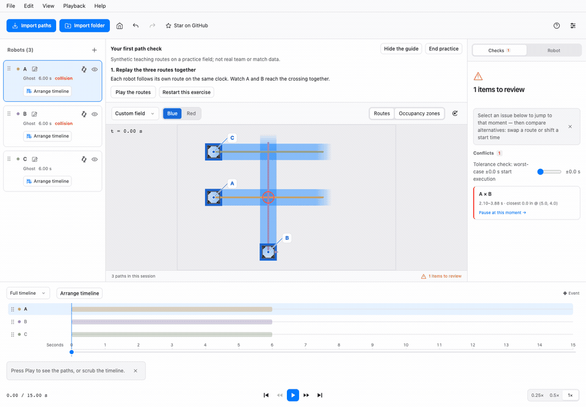

# PathBlender

**English** | [简体中文](README.zh-CN.md) | [繁體中文（香港）](README.zh-Hant.md) | [Español](README.es.md) | [Français](README.fr.md) | [Türkçe](README.tr.md) | [Português (Brasil)](README.pt-BR.md) | [עברית](README.he.md)

PathBlender is a free, open-source FRC autonomous path viewer. Import your
alliance partners' routes onto one field and a shared timeline to compare
start times and check for potential collisions.

[**Try it in your browser**](https://lyt259.github.io/PathBlender/) ·
[Download the desktop app](https://github.com/LYT259/pathblender/releases) ·
[**Star PathBlender**](https://github.com/LYT259/pathblender) ·
[**Follow me on GitHub**](https://github.com/LYT259)

*The demo uses synthetic practice routes, not a real match.*

If PathBlender looks useful, please [give it a Star](https://github.com/LYT259/pathblender).
You can also [follow me](https://github.com/LYT259) for updates and future projects.

## Get started

1. Open the web app, or download the desktop app for offline use at events.
   To try it without team files, select **Try your first path check** on the welcome screen.
2. Ask alliance partners for the relevant path/auto files from their robot
   projects. A USB drive works without internet; you don't need their entire
   codebases. Import the files or folders together. For a PathPlanner `.auto`,
   include every referenced `.path` in the same batch.
3. Play, pause or scrub the timeline. Select a reported conflict to jump to
   that moment, and compare different start times or routes.
4. Apply agreed changes in the team's planning tool or robot code and test
   them on the robot. On desktop, save the session or export a GIF replay or
   solution package to share.

[Full guide and FAQ](docs/user-guide.en.md) · [简体中文指南](docs/user-guide.zh.md)

## Features and formats

- Shared playback with adjustable start times and a route library.
- Robot-overlap and field-boundary checks.
- 2D and 3D views with FRC 2022–2026 fields; custom fields in 2D.
- Multiple interface languages and light/dark themes.

| Files | How they are used |
| --- | --- |
| Choreo `.traj` | Replay the sampled trajectory stored in the file. |
| Collaborative PathPlanner `.ghostauto` | Import the trajectory, bumper geometry and team name. |
| PathPlanner `.path` / `.auto` | Generate trajectories locally; see timing limits below. |
| PathPlanner `settings.json` | Apply robot dimensions and supported dynamics to individual `.path` imports. |
| PathBlender `.pb` | Save and reopen sessions on desktop; legacy `.ghpb.json` files also open. |

## Timing and limitations

PathBlender compares imported plans. It does not run robot code or read
`.wpilog` / `.hoot` logs, and its collision checks depend on the paths,
timing and robot dimensions supplied.

- **PathPlanner `.path`:** generation reads supported speed and acceleration
  constraints from the file. Robot configuration starts with defaults;
  applying a compatible `settings.json` profile can regenerate an individual
  path using supported robot parameters. Missing parameters still use defaults.
- **PathPlanner `.auto`:** trajectories currently use the default robot
  configuration. Explicit waits are included, but named-command durations
  are unknown and add no time. Parallel/race groups are approximated as
  sequential; unsupported commands are skipped with warnings.
- **Check results on the robot.** Generated timing can differ from actual
  execution. A clear timeline does not guarantee a collision-free auto,
  especially when robots pass close to each other.

## Download

Get the desktop app from [GitHub Releases](https://github.com/LYT259/pathblender/releases):

| Platform | Download |
| --- | --- |
| macOS 13+ | Universal DMG for Apple Silicon and Intel |
| Windows x86_64 | `*_x64-setup.exe` |
| Linux x86_64 | AppImage, DEB or RPM |

Desktop includes session saving, GIF replay and solution-package export.
For in-app Linux updates, use AppImage; DEB/RPM users install the newer package.
See the [user guide](docs/user-guide.en.md) for installation and update details.

The [web app](https://lyt259.github.io/PathBlender/) supports file/folder
imports, playback and checking, without session saving or exports.
A [backup mirror](https://pathblender.pages.dev) is also available.

## Privacy

Path files are parsed locally and are not uploaded. No account is required,
and there is no telemetry or analytics. The browser downloads the app and
its assets; desktop update checks contact GitHub Releases.

## Feedback and support

Report bugs or import problems through [GitHub Issues](https://github.com/LYT259/pathblender/issues).
The [feedback template](docs/community/feedback-template.md) lists useful details;
you do not need to publish private path files.

Please [**Star PathBlender**](https://github.com/LYT259/pathblender) if you find it useful,
and [**follow me on GitHub**](https://github.com/LYT259) for updates and future projects.

For contributors: [development checks](docs/development-checks.md).

*This README was drafted and revised with AI.*

## License & attribution

**Own code: Apache-2.0** — see [LICENSE](./LICENSE).
Third-party models, field artwork, example routes, and trademarks have separate
terms; the code license does not automatically cover them. Read
[NOTICE.md](./NOTICE.md), especially SDS's express permission for SDS MK5i
CAD-derived visualization assets and the separate remaining third-party scope,
before reusing assets. See the
[asset licensing guide](./docs/asset-licensing.md) for provenance and rights concerns.
PathPlanner (MIT), Choreo (BSD-3), AdvantageScope assets (BSD-3), and
WPILib (BSD-3) each remain under their own licenses and are credited in
NOTICE.

Field artwork and game names are owned by FIRST and used for
non-commercial team strategy purposes following FIRST's trademark &
copyrighted-materials policy, rechecked before each public release:

> FIRST®, FIRST® Robotics Competition, and FIRST® Tech Challenge, are registered trademarks of FIRST® (www.firstinspires.org) which is not overseeing, involved with, or responsible for this activity, product, or service.

For the FIRST copyrighted materials included in PathBlender:

> ©2025 For Inspiration and Recognition of Science and Technology (FIRST). Used by special permission. All rights reserved. FIRST is not overseeing, involved with, or responsible for this activity, product, or service.
