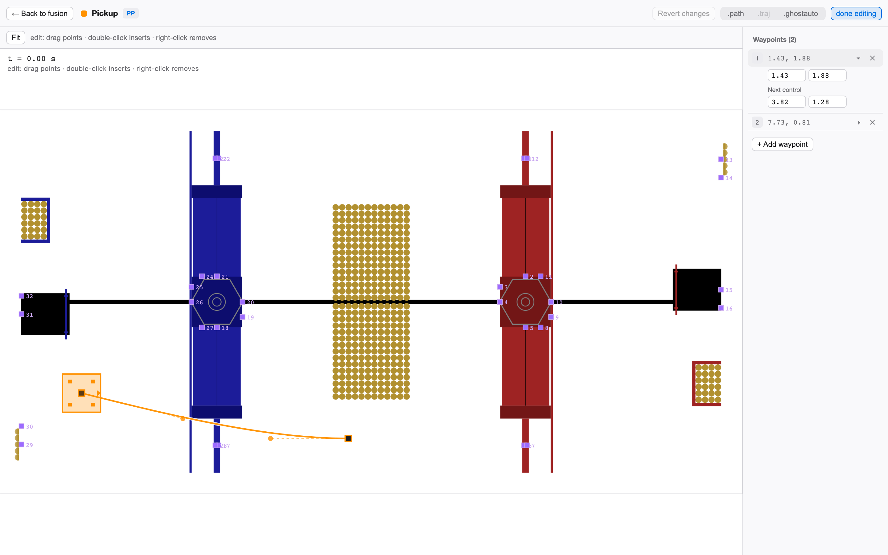
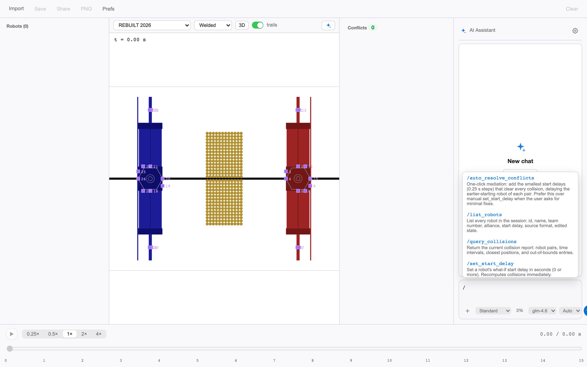
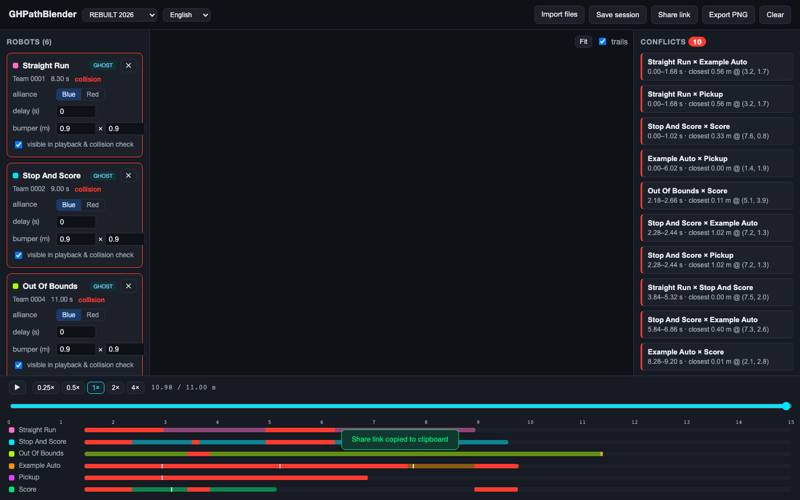
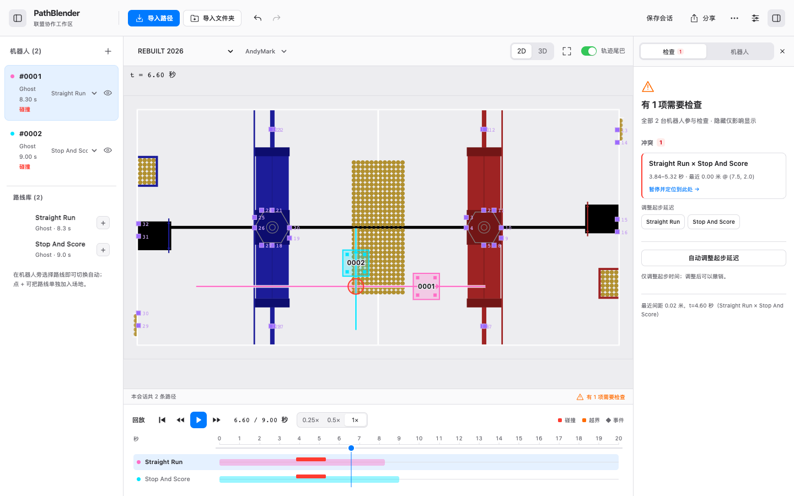

# PathBlender

**English** | [简体中文](README.zh-CN.md) | [繁體中文](README.zh-TW.md)

**Multi-source autonomous path fusion viewer for FRC alliance strategy.**

Blend autonomous path files exported from different toolchains onto one
field: unified-timeline playback and collision checking, built for
**alliance strategy groups** — not just the programming team.

## Why

In FRC qualification and playoff matches, all three robots in an alliance
run their autonomous programs on the same 26×54 ft field at the same
time. Teams plan paths in different tools (Choreo, PathPlanner), and
nobody can see whether the resulting autos will collide until they
actually do — in a match.

PathBlender fills that gap:

- **Multi-toolchain import** — Choreo `.traj`, Team 103 Collaborative fork
  `.ghostauto`, and native PathPlanner `.path` / `.auto` (trajectory
  generation ported to TypeScript — no other browser tool does this);
- **Unified timeline playback** — every robot on one 15 s autonomous
  clock, play / pause / scrub / speed control (0.25×–4×);
- **Collision & interference checking** — bumper-rectangle OBB overlap
  along the whole timeline, with a conflict report (who, when, where),
  out-of-bounds detection, and a minimum-separation report. **Auto-resolve**
  proposes the smallest set of start delays that clears every conflict;
- **3D field view** — official field models for FRC 2022–2026 (welded and
  AndyMark variants where they differ), free orbit with an Onshape-style
  ViewCube in the corner to snap back to standard views. The 2D view
  stays the fast tactical overlay;
- **Path editor** — a dedicated workspace (Choreo/PathPlanner style):
  drag waypoints on the field or edit exact numbers in the side panel;
  every edit regenerates the trajectory and exports back to
  `.path` / `.traj` / `.ghostauto`;

  

- **Optional AI assistant** — bring your own key (智谱 Z.ai /
  Claude (Anthropic) / OpenAI / DeepSeek / local Ollama), default off.
  Chat-style composer with a slash-command palette over the whitelisted
  action set, one-shot skills, permission tiers (standard / full access),
  per-model display names and context sizes, and a stop button. The
  assistant never executes model-generated code — collision verdicts
  always come from the deterministic detector;

  

- **Zero install, zero upload** — a pure static web app. Files are parsed
  locally in your browser and never leave it (the AI calls above are the
  only network feature, strictly user-configured and off by default);
- **Also a desktop app** — the same build ships as a lightweight Tauri
  shell (no backend, no sidecars) with in-app auto-update: `npm run tauri
  build -w packages/desktop` produces PathBlender.app + .dmg. Windows and
  Linux installers are staged for a follow-up release.

## Quick start

1. Open the app in any modern browser (link to be published at release).
2. Drag in path files from every alliance partner — `.traj`, `.ghostauto`,
   `.path`, `.auto`, mixed freely. Multi-select works; bad files are
   reported without stopping the good ones.
3. Press **play**. Collisions show up as red rings on the field and as
   entries in the conflict panel — click one to jump the clock to that
   moment, or press **Auto-resolve** for the minimal-delay proposal.
4. Fine-tune: **start delay** inputs (what-if only — source files are
   never modified), per-robot alliance / geometry / team number, or open
   the **path editor** for waypoint-level fixes.
5. **Share** the result: save a session file, copy a share link (the whole
   session compressed into the URL — nothing is uploaded anywhere), or
   export a PNG for your alliance chat.

## Supported formats

| Format | Source | Notes |
|---|---|---|
| `.traj` | Choreo (SleipnirGroup, BSD-3) | All known schema versions; time-sampled states |
| `.ghostauto` | Collaborative PathPlanner fork (FRC 103, MIT) | Includes bumper geometry & team name |
| `.path` | PathPlanner (MIT) | Trajectory generated locally — ported PathPlannerLib algorithm |
| `.auto` | PathPlanner (MIT) | Path sequences with wait/command semantics |
| `.ghpb.json` | This project | Session file: all robots + settings + field |

## Privacy

Path files are parsed **entirely in your browser**. There is no backend,
no account, no telemetry, and no analytics — the app ships zero network
calls. Share links contain only the compressed session data itself (in
the URL hash, which never leaves the page unless you copy it). API keys
live in local storage only and never enter sessions, share links,
exports, or logs.

Also included: red/blue alliance normalization per robot, per-robot
geometry editing and team-number annotations, eight season fields
(2018–2020, 2022–2026 — 2021 has no public orthographic field asset)
with official AprilTag overlays + custom field import with calibration
(WPILib/PhotonVision JSON), and English / 简体中文 / 繁體中文 UI in light
and dark themes (follows the system).

Full walkthrough per tool and an FAQ:
[English](docs/user-guide.en.md) ·
[简体中文](docs/user-guide.zh.md).

## Status

Working MVP — everything above is implemented and regression-tested
(127 automated tests + a real-browser walkthrough). Not yet deployed
publicly. See [`PathBlender_可行性研究报告.md`](./PathBlender_可行性研究报告.md)
(feasibility study, in Chinese) for the full plan: market research,
file-format analysis, roadmap, and risk register.

## License & attribution

**Apache-2.0** — see [LICENSE](./LICENSE) and [NOTICE.md](./NOTICE.md).
PathPlanner (MIT), Choreo (BSD-3), AdvantageScope assets (BSD-3), and
WPILib (BSD-3) each remain under their own licenses and are credited in
NOTICE.

Field artwork and game names are owned by FIRST and used for
non-commercial team strategy purposes following FIRST's trademark &
copyrighted-materials policy, rechecked before each public release:

> FIRST®, FIRST® Robotics Competition, and FIRST® Tech Challenge, are
> registered trademarks of FIRST® (www.firstinspires.org) which is not
> overseeing, involved with, or responsible for this activity, product,
> or service.
