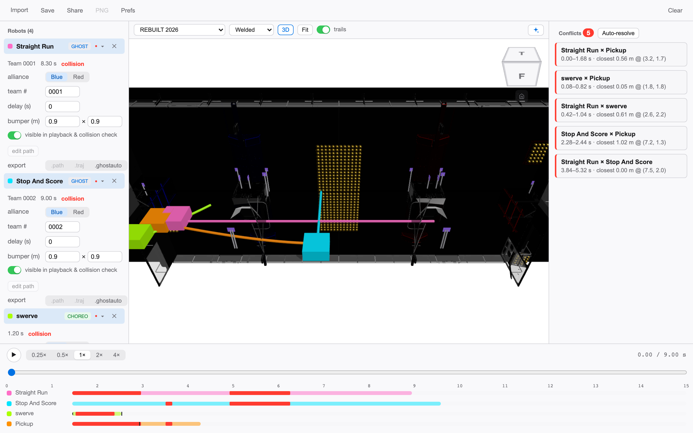

# PathBlender

**English** | [简体中文](README.zh-CN.md) | [繁體中文](README.zh-Hant.md)

**Multi-source autonomous path fusion viewer for FRC alliance strategy.**

Blend autonomous path files exported from different toolchains onto one
field: unified-timeline playback and collision checking, built for
**alliance strategy groups** — not just the programming team. It is a
**viewer**: analyze the autos you have, find the conflicts, fix them in
the tool that owns the path, re-import, and check again.

## Why

In FRC qualification and playoff matches, all three robots in an alliance
run their autonomous programs on the same field at the same time. Teams
plan paths in different tools (Choreo, PathPlanner), and nobody can see
whether the resulting autos will collide until they actually do — in a
match.

PathBlender fills that gap:

- **Multi-toolchain import** — Choreo `.traj`, Team 103 Collaborative fork
  `.ghostauto`, and native PathPlanner `.path` / `.auto` (trajectory
  generation ported to TypeScript — no other browser tool does this);
- **Unified timeline playback** — every robot on one shared autonomous
  clock (15 s; 20 s for the 2026 season), play / pause / scrub / speed
  control (0.25×–1×);
- **Collision & interference checking** — bumper-rectangle OBB overlap
  along the whole timeline, with a conflict report (who, when, where) and
  out-of-bounds markers;
- **3D field view** — official field models for FRC 2022–2026 (welded and
  AndyMark variants where the two constructions differ), free orbit with
  one-click fit; imported custom fields stay 2D. The 2D view offers a
  schematic and a rendered artwork style per season, with the official
  AprilTag layout overlaid;
- **Route library** (desktop app) — import a whole folder from any team's
  deploy directory: bystander files are skipped, every route lands in a
  library, and a picker beside each robot switches its active auto live.
  PathPlanner `settings.json` files apply real bumper dimensions;

- **Zero install, zero upload (web)** — a pure static web app: files are
  parsed locally in your browser, and the web build makes **no network
  requests at all**;
- **Also a desktop app** — the same UI in a lightweight Tauri shell for
  macOS, adding session save/open, GIF replay and solution-package export,
  folder import and in-app updates (stable or beta channel). Its only
  network activity is the
  update check you trigger, which contacts GitHub Releases.

## Quick start

1. Get the app (see below) — or, with no files at hand, press **Try the
   example** on the welcome screen to load a built-in multi-robot session
   and see playback and collision checking immediately.
2. Import path files from every alliance partner — `.traj`, `.ghostauto`,
   `.path`, `.auto`, mixed freely (desktop: one file or a whole folder;
   every `.path` referenced by an `.auto` must arrive in the same batch).
   Broken files are reported individually without stopping the good ones.
3. Press **play**. Conflicts show up as red rings on the field, red
   segments on the timeline, and entries in the conflict panel (who, when,
   where) — click one to jump the clock to that moment.
4. Investigate: switch a robot's route from the library, flip the
   alliance view, or step the clock. When you know what has to change,
   make the change in the owning team's tool, re-export, and drop the new
   file in — the session updates in place.
5. **Share** the result: save a session file, or export a GIF replay of the
   2D view — plus a solution package with everything the partner needs —
   for the alliance chat (desktop app).

## Supported formats

| Format | Source | Notes |
|---|---|---|
| `.traj` | Choreo (SleipnirGroup, BSD-3) | All known schema versions; time-sampled states |
| `.ghostauto` | Collaborative PathPlanner fork (FRC 103, MIT) | Includes bumper geometry & team name |
| `.path` | PathPlanner (MIT) | Trajectory generated locally — ported PathPlannerLib algorithm |
| `.auto` | PathPlanner (MIT) | Path sequences with wait/command semantics |
| `settings.json` | PathPlanner (MIT) | Bumper dimensions for the robots in that project |
| `.pb` | This project | Session file: all robots + settings + field (pre-rename `.ghpb.json` still opens) |

Fields: FRC 2022–2026 are built in, plus custom field import with
calibration and a WPILib/PhotonVision AprilTag layout JSON (use it for
any other season or a practice field).

## Where to get it

- **macOS desktop app** (Apple Silicon, macOS 13+) — download the
  `PathBlender_<version>_aarch64.dmg` from
  [GitHub Releases](https://github.com/LYT259/pathblender/releases), open
  it, and drag PathBlender to Applications. Updates: menu
  **PathBlender → Check for Updates…** (beta builds: enable the beta
  channel in **Preferences → Updates** first). Windows and Linux
  installers are not provided yet — the code is cross-platform and they
  are planned. The release page's other assets (`.tar.gz`, `.sig`,
  `.json`) are updater internals — you don't need them.
- **Web app** (viewer build: import, playback and checking; no session
  save / GIF and solution-package export / folder import) —
  [pathblender.pages.dev](https://pathblender.pages.dev), with a preview
  channel at [pathblender-preview.pages.dev](https://pathblender-preview.pages.dev).

## Privacy

Path files are parsed **entirely on your machine**. There is no backend,
no account, no telemetry, and no analytics. The web build ships zero
network calls; the desktop app contacts the network only for the update
check you trigger (GitHub Releases) — path files never leave the app.

Also included: a session-level red/blue alliance view, per-robot team
number annotations, the season fields above with official AprilTag
overlays, and a **41-language** UI — English / 简体中文 / 繁體中文（中國香港）/
繁體中文（中國台灣）/ Français / Español / Deutsch / Italiano / Português
(Brasil) / Nederlands / Polski / Čeština / Türkçe / Ελληνικά / עברית /
العربية / हिन्दी / 日本語 / 한국어, with the full list in the language menu —
in light and dark themes (follows the system).

Full walkthrough per tool and an FAQ:
[English](docs/user-guide.en.md) ·
[简体中文](docs/user-guide.zh.md).

## Feedback

Bugs, format-drift reports and season-field issues are exactly the
feedback we need. Open an issue at
[github.com/LYT259/pathblender/issues](https://github.com/LYT259/pathblender/issues) —
the [feedback template](docs/community/feedback-template.md) shows what
to include (you are never required to post your path files). Community
discussion lives in the project's Chief Delphi announcement thread.

## Status

Viewer scope as described above, implemented and regression-tested. Desktop
builds ship from [GitHub Releases](https://github.com/LYT259/pathblender/releases).

## Verification (for people changing the code)

Four checks, all run locally — none of them ships with the app:

| Layer | Command | What it proves |
| --- | --- | --- |
| Unit + jsdom suites | `npm test` (or `-w @pathblender/core` / `-w @pathblender/web`) | Parsers, geometry, fusion and collision maths, and component behaviour in a simulated DOM. |
| Pointer walkthrough | `npm run build -w @pathblender/web && npm run preview -w @pathblender/web`, then `node scripts/browser-walkthrough.mjs` | The production build driven with a real mouse and real files: folder import, the composer's click-and-drag placement, save/restore through an actual download, all 41 languages including RTL, artwork repaints, service worker, and 3D (model, lit robots, ViewCube picks, season switches). |
| Keyboard walkthrough | same preview server, then `node scripts/keyboard-walkthrough.mjs` | The same app driven with the keyboard only — every main workflow has to be completable without a mouse. |
| Website gate check | `VITE_VIEWER_ONLY=1 npm run build -w @pathblender/web`, then `node scripts/serve-dist.mjs 4179` and `VIEWER_BASE=http://localhost:4179/ node scripts/viewer-check.mjs` | The hosted viewer build keeps import, playback, collision checking and timeline arranging, asks nothing outside its own origin on load, follows the OS language on first visit — and cannot write a file out through any route, including the Ctrl/Cmd+S accelerators that have no button at all. Re-run it whenever a save or export affordance moves. |

All three browser harnesses print `PASS`/`FAIL` per step, exit non-zero on any
failure and save screenshots to `/tmp/pb-shots`. Run them after any
user-visible change and before a release; when the UI changes, update the
harness in the same pull request — a check that targets a retired control
fails the next person rather than protecting them.

中文：以上四项都只在本机跑、不随软件发布。单元测试验算法与组件行为；两个
走查脚本在真实浏览器里把成品点一遍（一个只用鼠标，一个只用键盘）；最后一条是网站
门控自查——发布出去的查看器构建要留住导入/回放/检查/编排，首屏不发本站以外的
请求、首访跟随系统语言，同时任何入口都不能写文件（包括根本没有按钮的
Ctrl/Cmd+S 快捷键）。改动界面或导出入口时，请在同一个 PR 里同步这些脚本。

## License & attribution

**Apache-2.0** — see [LICENSE](./LICENSE) and [NOTICE.md](./NOTICE.md).
PathPlanner (MIT), Choreo (BSD-3), AdvantageScope assets (BSD-3), and
WPILib (BSD-3) each remain under their own licenses and are credited in
NOTICE.

Field artwork and game names are owned by FIRST and used for
non-commercial team strategy purposes following FIRST's trademark &
copyrighted-materials policy, rechecked before each public release:

> FIRST®, FIRST® Robotics Competition, and FIRST® Tech Challenge, are
> registered trademarks of FIRST® (www.firstinspires.org) which is not
> overseeing, involved with, or responsible for this activity, product,
> or service.
