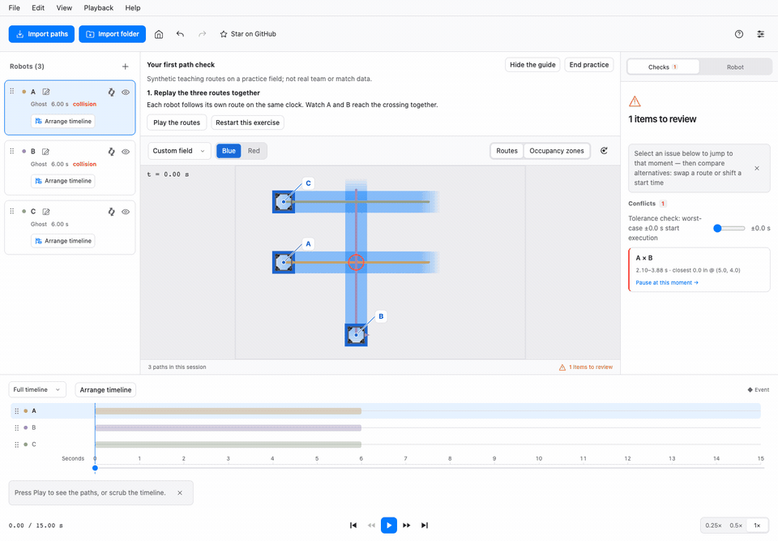

# PathBlender

[English](README.md) | **简体中文** | [繁體中文（香港）](README.zh-Hant.md) | [Español](README.es.md) | [Français](README.fr.md) | [Türkçe](README.tr.md) | [Português (Brasil)](README.pt-BR.md) | [עברית](README.he.md)

PathBlender 是免费的开源 FRC 自动路径查看器。把联盟伙伴的路线导入同一块场地和时间轴，比较出发时间，检查潜在碰撞。

[**在线试用**](https://lyt259.github.io/PathBlender/) ·
[下载桌面版](https://github.com/LYT259/pathblender/releases) ·
[**给 PathBlender 点 Star**](https://github.com/LYT259/pathblender) ·
[**在 GitHub 上关注我**](https://github.com/LYT259)

*演示使用合成练习路线，不是真实比赛。*

如果觉得 PathBlender 有用，欢迎[给仓库点 Star](https://github.com/LYT259/pathblender)，也可以[关注我](https://github.com/LYT259)，了解后续更新和新项目。

## 快速上手

1. 打开网页版，或提前下载桌面版以便赛场离线使用。没有队伍文件时，可以在欢迎页选择**试做第一次路径检查**。
2. 请联盟伙伴从机器人项目里复制所需的路径／自动程序文件，无需提供整个代码库。没有网络时可以用 USB 闪存盘交换。一起导入文件或文件夹；PathPlanner `.auto` 引用的所有 `.path` 需要同批导入。
3. 播放、暂停或拖动时间轴。点击冲突报告跳到对应时刻，比较不同的出发时间或路线。
4. 在所属队伍的路径规划工具或机器人代码中落实调整，并在实车上验证。桌面版还可保存会话、导出 GIF 回放或方案包分享。

[完整指南与常见问题](docs/user-guide.zh.md) · [English guide](docs/user-guide.en.md)

## 功能与格式

- 共享时间轴回放、可调整的出发时间和路线库。
- 机器人重叠与场地越界检查。
- 内置 FRC 2022–2026 场地的 2D／3D 视图；自定义场地使用 2D 视图。
- 多语言界面及深浅色主题。

| 文件 | 用途 |
| --- | --- |
| Choreo `.traj` | 回放文件中保存的采样轨迹。 |
| Collaborative PathPlanner `.ghostauto` | 导入轨迹、保险杠几何与队名。 |
| PathPlanner `.path` / `.auto` | 本地生成轨迹；时间限制见下文。 |
| PathPlanner `settings.json` | 为单独导入的 `.path` 应用机器人尺寸及支持的动力学参数。 |
| PathBlender `.pb` | 在桌面版保存与打开会话；兼容旧 `.ghpb.json` 文件。 |

## 时间与限制

PathBlender 比较导入的规划，不运行机器人代码，也不读取 `.wpilog`／`.hoot` 日志。碰撞检查取决于提供的路径、时间和机器人尺寸。

- **PathPlanner `.path`：**生成轨迹时读取文件中支持的速度、加速度约束。机器人配置初始使用默认值；应用兼容的 `settings.json` 配置后，可使用支持的机器人参数重新生成单条路径。缺失参数仍使用默认值。
- **PathPlanner `.auto`：**目前使用默认机器人配置生成轨迹。显式等待会计入时间；命名命令的耗时未知，不计入时间轴。并行／race 组按顺序执行近似处理，不支持的命令会跳过并警告。
- **在实车上验证结果。**生成的时间可能与实际执行不同。时间轴未显示冲突，不代表自动程序一定不会碰撞，尤其是机器人距离很近时。

## 下载

从 [GitHub Releases](https://github.com/LYT259/pathblender/releases) 获取桌面版：

| 平台 | 下载文件 |
| --- | --- |
| macOS 13+ | Apple Silicon 与 Intel 通用的 Universal DMG |
| Windows x86_64 | `*_x64-setup.exe` |
| Linux x86_64 | AppImage、DEB 或 RPM |

桌面版提供会话保存、GIF 回放和方案包导出。Linux 的应用内更新使用 AppImage；DEB／RPM 用户安装新版软件包。安装与更新细节见[使用指南](docs/user-guide.zh.md)。

[网页版](https://lyt259.github.io/PathBlender/)支持文件／文件夹导入、回放与检查，不提供会话保存或导出；另有[备用镜像](https://pathblender.pages.dev)。

## 隐私

路径文件在本机解析，不会上传。无需账号，没有遥测或分析统计。浏览器下载应用及资源；桌面版检查更新时连接 GitHub Releases。

## 反馈与支持

通过 [GitHub Issues](https://github.com/LYT259/pathblender/issues)反馈 Bug 或导入问题。[反馈模板](docs/community/feedback-template.md)列出了有帮助的信息，无需公开私有路径文件。

如果觉得有用，欢迎[**给 PathBlender 点 Star**](https://github.com/LYT259/pathblender)，并[**在 GitHub 上关注我**](https://github.com/LYT259)，了解后续更新和新项目。

开发者请参阅[开发检查说明](docs/development-checks.md)。

*本 README 使用 AI 起草和修订。*

## 许可与归因

**Apache-2.0**——见 [LICENSE](./LICENSE) 和 [NOTICE.md](./NOTICE.md)。PathPlanner（MIT）、Choreo（BSD-3）、AdvantageScope 素材（BSD-3）、WPILib（BSD-3）各自保持原有许可，在 NOTICE 中逐一致谢。
SDS 已明确书面许可 PathBlender 使用并分发 SDS MK5i 的 CAD 衍生可视化素材；该许可不覆盖 WCP/Kraken X60 或用户自建车架，详见 NOTICE。

场地美术与赛事名称归 FIRST 所有，按 FIRST 商标与版权材料政策用于非商业队伍策略用途，每次公开发版前复查：

> FIRST®、FIRST® Robotics Competition 和 FIRST® Tech Challenge 是 FIRST®（www.firstinspires.org）的注册商标，FIRST® 未监督、未参与、也不对本活动、产品或服务负责。

> FIRST®, FIRST® Robotics Competition, and FIRST® Tech Challenge, are registered trademarks of FIRST® (www.firstinspires.org) which is not overseeing, involved with, or responsible for this activity, product, or service.

For the FIRST copyrighted materials included in PathBlender:

> ©2025 For Inspiration and Recognition of Science and Technology (FIRST). Used by special permission. All rights reserved. FIRST is not overseeing, involved with, or responsible for this activity, product, or service.
