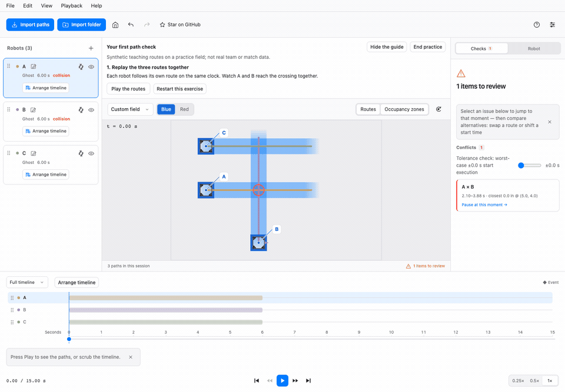
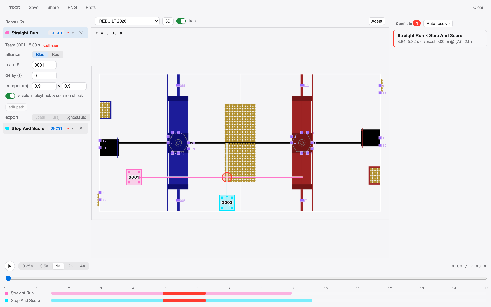

# PathBlender

[English](README.md) | **简体中文** | [繁體中文（香港）](README.zh-Hant.md) | [Español](README.es.md) | [Français](README.fr.md) | [Türkçe](README.tr.md) | [Português (Brasil)](README.pt-BR.md) | [עברית](README.he.md)

**把联盟各队的自动路线放到同一块场地一起看。在比赛前发现冲突。**

[**在浏览器里试试**](https://pathblender.pages.dev) ·
[下载桌面版](https://github.com/LYT259/pathblender/releases) ·
[第一次路径检查](docs/user-guide.zh.md#无需文件试做一次检查) ·
[在 GitHub 上点 Star](https://github.com/LYT259/pathblender)

PathBlender 把 Choreo 和 PathPlanner 的路线放到同一块场地、同一个时钟上，服务 FRC 联盟策略。一起回放机器人、找到冲突，在敲定方案前比较不同的出发时间。

*练习场上的原创教学路线，不是真实比赛。从欢迎页就能试做你自己的检查——无需文件、无需安装、无需账号。*

- **把不同工具汇到一起：**导入 Choreo、PathPlanner 和 Collaborative 的 `.ghostauto` 文件。
- **让时间安排看得见：**共同回放、碰撞检查、会话级出发时间比较。
- **路径留在你的机器上：**解析与分析全部本地完成。

如果你觉得它有用或有趣，欢迎**给仓库点 Star**，支持 PathBlender，也方便以后找到它。

## 为什么做这个

FRC 资格赛和淘汰赛中，联盟的三台机器人同时在同一块场地上跑自动程序。各队用不同的工具（Choreo、PathPlanner）规划路径，分开对照各自的导出文件，赛前很难发现路线重叠。

PathBlender 补上这个空缺：

- **多工具链导入**——Choreo `.traj`、103 队 Collaborative fork `.ghostauto`、原生 PathPlanner `.path` / `.auto`（轨迹生成已移植到 TypeScript）；
- **统一时间轴回放**——所有机器人在同一条自动时钟上（15 秒；2026 赛季 20 秒），播放/暂停/拖动/变速（0.25×–1×）；
- **碰撞与干涉检查**——全程保险杠矩形 OBB 重叠检测，冲突报告（谁和谁、什么时刻、在哪里）、越界标记；
- **3D 场地视图**——2022–2026 官方场地 3D 模型（焊接场/AndyMark 场两种结构有差异时都提供），自由环绕、一键适配；自定义导入的场地保持 2D。2D 视图每个赛季提供示意图与渲染图两种底图，叠加官方 AprilTag 布局；
- **路线库**——整包导入一个队伍的 deploy 目录：无关文件自动跳过，所有路线进入路线库，每台机器人旁的选择器实时切换当前自动；PathPlanner `settings.json` 可把真实保险杠尺寸应用到机器人；

- **零安装、零上传（网页版）**——静态网页应用：路径文件在你的浏览器里本地解析与检查；
- **也有桌面版**——同一界面装入轻量 Tauri 壳（macOS、Windows、Linux），增加会话保存/打开、GIF 回放与方案包导出、应用内更新（stable 或 beta 通道）。桌面版检查更新时连接 GitHub Releases。

## 快速上手

1. 获取应用（见下）——或按欢迎页的**试做第一次路径检查**，跟着引导用三条合成教学路线完成一次练习；**体验示例**则打开另一个内置的多机器人会话。
2. 把各队的路径文件导入——`.traj`、`.ghostauto`、`.path`、`.auto` 随意混拖（网页版与桌面版都支持单个文件或整个文件夹；`.auto` 引用到的每个 `.path` 必须同批导入）。坏文件会逐个报错说明原因，不影响其他文件导入。
3. 按**播放**。冲突处：场地红色圆环 + 时间轴红色区段 + 冲突面板列出「谁和谁、什么时刻、在哪里」——点一条跳到那个瞬间。
4. 排查：从路线库给机器人换一条路线、切换联盟视角、拨动时间轴。确定问题所在后，回到所属队伍的工具修改、重新导出、把新文件拖进来——会话原地更新。
5. **分享**：保存会话文件，或导出 2D 视图的 GIF 回放／方案包发群（桌面版功能）。

## 支持的格式

| 格式 | 来源 | 说明 |
|---|---|---|
| `.traj` | Choreo（BSD-3） | 所有已知 schema 版本；时间采样状态 |
| `.ghostauto` | Collaborative fork（103 队，MIT） | 自带保险杠几何与队名 |
| `.path` | PathPlanner（MIT） | 本地生成轨迹——移植的 PathPlannerLib 算法 |
| `.auto` | PathPlanner（MIT） | 路径序列 + 等待/命令语义 |
| `settings.json` | PathPlanner（MIT） | 该项目机器人的保险杠尺寸 |
| `.pb` | 本项目 | 会话文件：全部机器人 + 设置 + 场地（旧名 `.ghpb.json` 仍可打开） |

场地：内置 FRC 2022–2026，另支持自定义场地导入（标定 + WPILib/PhotonVision AprilTag 布局 JSON）——其他赛季或练习场地可走自定义导入。

## 获取方式

- **macOS**（macOS 13+；目前仅支持 Apple Silicon）——从 [GitHub Releases](https://github.com/LYT259/pathblender/releases) 下载 `*_aarch64.dmg`，打开后把 PathBlender 拖入「应用程序」。Apple Silicon 与 Intel 通用包计划后续提供。
- **Windows**（x86_64）——安装包尚未发布，计划后续提供 `*_x64-setup.exe`。
- **Linux**（x86_64）——DEB / AppImage / RPM 包尚未发布。发布后，应用内更新走 AppImage；DEB/RPM 用户下载新包覆盖安装即可更新。
- 更新：菜单 **PathBlender → 检查更新…**（Beta 版先在 **偏好设置 → 更新** 打开 Beta 通道）。发布页上的其它文件（`.tar.gz`、`.sig`、`.json`）是更新器内部文件，无需下载。
- **网页版**（查看器构建：与桌面版同样的导入——单个文件或整个文件夹——加上回放与检查；无会话保存/打开、GIF 回放与方案包导出）——[pathblender.pages.dev](https://pathblender.pages.dev)。

## 隐私

路径文件**完全在你的设备上解析**。零后端、零账号、零遥测、零分析。浏览器只获取应用本体与其资源；桌面版检查更新时连接 GitHub Releases。路径文件不会被上传。外部链接在你点击时才打开其目标地址。

另含：会话级红蓝联盟视角、机器人队号标注、上述赛季场地与官方 AprilTag 叠加、43 种界面语言——English (United States) / English (United Kingdom) / 简体中文 / 繁體中文（香港）/ 繁體中文（澳門）/ 繁體中文（台灣）/ Français / Español / Deutsch / Italiano / Português (Brasil) / Nederlands / Polski / Čeština / Türkçe / Ελληνικά / עברית / العربية / हिन्दी / 日本語 / 한국어，完整清单见界面语言菜单——深浅色主题跟随系统。

完整操作指南与 FAQ：[English](docs/user-guide.en.md) · [简体中文](docs/user-guide.zh.md)。

## 反馈

Bug、格式漂移报告、赛季场地问题正是我们需要的反馈。请到
[github.com/LYT259/pathblender/issues](https://github.com/LYT259/pathblender/issues)
提 issue——[反馈模板](docs/community/feedback-template.md)说明该写哪些内容（绝不会要求你公开路径文件）。社区讨论见项目的 Chief Delphi 发布帖。

## 状态

上述查看器范围已实现并通过回归测试（单元测试套件 + 脚本化真实浏览器走查）。桌面版从 [GitHub Releases](https://github.com/LYT259/pathblender/releases) 发布。

## 许可与归因

**Apache-2.0**——见 [LICENSE](./LICENSE) 和 [NOTICE.md](./NOTICE.md)。PathPlanner（MIT）、Choreo（BSD-3）、AdvantageScope 素材（BSD-3）、WPILib（BSD-3）各自保持原有许可，在 NOTICE 中逐一致谢。
SDS 已明确书面许可 PathBlender 使用并分发 SDS MK5i 的 CAD 衍生可视化素材；该许可不覆盖 WCP/Kraken X60 或用户自建车架，详见 NOTICE。

场地美术与赛事名称归 FIRST 所有，按 FIRST 商标与版权材料政策用于非商业队伍策略用途，每次公开发版前复查：

> FIRST®、FIRST® Robotics Competition 和 FIRST® Tech Challenge 是 FIRST®（www.firstinspires.org）的注册商标，FIRST® 未监督、未参与、也不对本活动、产品或服务负责。
