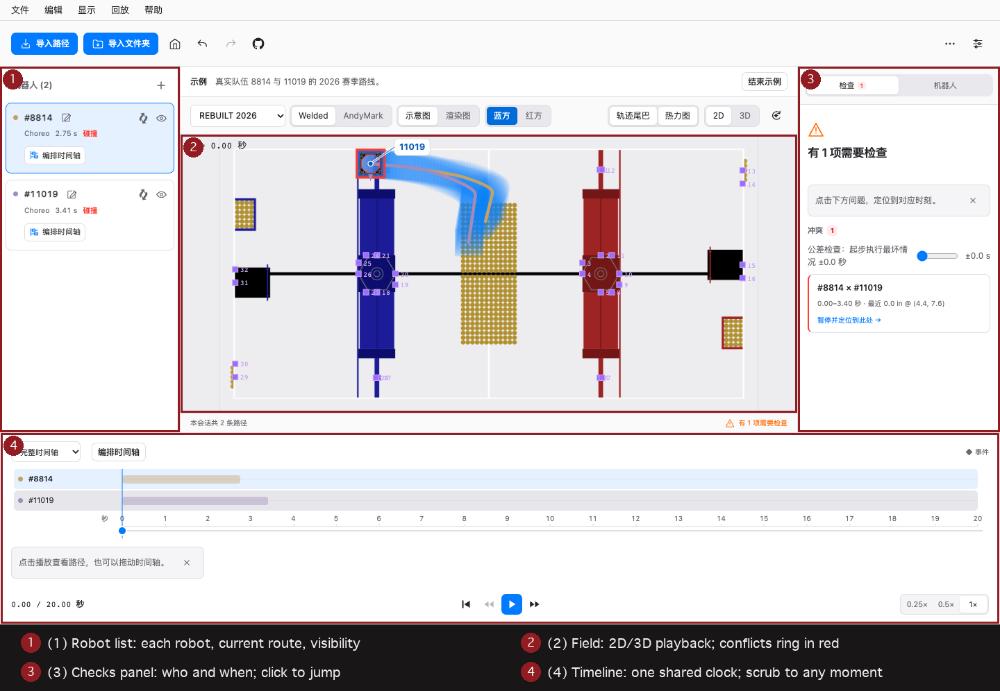

# PathBlender User Guide (for alliance strategy groups)

**Before a match: put every alliance partner's auto on one field, replay
them together, and catch robot-to-robot conflicts while there is still time
to change the plan.**

A pre-match coordination tool for alliance strategy and programming
groups. **All files are parsed on your machine — nothing is uploaded
anywhere.** PathBlender is a viewer: it shows you the problem; the fix
happens in the tool that owns the path. An in-app **quick guide** ships
with the app (Help menu → Quick guide, or the link on the welcome screen)
and reads offline.

## Your first alliance path check

Seven steps from zero to a finished check. No files yet? Every step can be
practised first on the built-in **Try the example** session.

### 1. Collect each team's files

| Team's tool | File(s) | How |
|---|---|---|
| Choreo | `.traj` | Export the trajectory from Choreo |
| PathPlanner | `.path` + `.auto` | Take the files from the project folder; **every `.path` referenced by an `.auto` must be imported in the same batch** |
| PathPlanner (bonus) | `settings.json` | Import it too and every robot gets the project's real bumper size |
| 103 Collaborative fork | `.ghostauto` | Export a ghost from the fork — it carries the robot size and team name |

**What you should have**: at least one path file per team, with each
`.auto` in the same folder as the `.path` files it references so they can
be selected together.
**If not**: a lone `.path` still imports — the trajectory is regenerated
with a generic robot profile and flagged "timing is an estimate" (see FAQ).

### 2. Import every team's routes

On the welcome screen press **Import path files** — multi-select and mixed
formats in one go — or **Import folder** to ingest a team's whole deploy
directory (bystander files are skipped; every route lands in the library).

**What you should see**: one robot per team (with team number) in the
robot list on the left, the field in the middle, the timeline at the
bottom. A broken file reports why it failed without blocking the rest.

### 3. Check the basics

Four things to verify before analysing on top of them:

- **Season & field**: the selector at the top shows this season
  (2022–2026 are built in);
- **Bumper sizes**: click a robot and check the **Details** tab on the
  right; `.ghostauto` and `settings.json` imports carry real sizes, the
  rest default to the season's rule size;
- **Red/blue alliance**: the toggle in the toolbar — switch to the half
  those robots actually start their match on;
- **Where time comes from**: `.traj` / `.ghostauto` timings come from the
  export; a `.path` without its `settings.json` is a local estimate —
  treat borderline calls as advisory.

### 4. Replay everything together

Press **Play**. Every robot runs on one shared clock (t = 0 is the start
of the autonomous period): pause, scrub the timeline to any moment, run
at 0.25×–1×, or step half a second at a time.

**What you should see**: all the robots moving on the field at once, one
band per robot on the timeline showing its own true start and end.

### 5. Locate the check results

A conflict shows up in three places at once: a **red ring** on the field,
a **red segment** on the timeline, and an entry in the checks panel —
**which two robots, at what time, where**.

**Where to click**: any entry in the checks panel jumps the clock straight
to that moment; robots leaving the field are marked out of bounds at the
exact times it happens.
**What you should see**: the clock jumps and the two robots meet/overlap
inside the red ring.

### 6. Compare plans

When a conflict appears, compare the alternatives in PathBlender first,
then decide who changes what:

- **Switch routes**: the picker beside each robot swaps in another route
  from its library live (undo switches back);
- **Shift start times**: press the robot's **Arrange** (or E) and adjust
  when it starts; playback follows the new plan immediately;
- **Spatial transforms**: see "Alliance switch vs. mirror" below — they
  act on different things; don't mix them up.

Every adjustment here is an analysis view: **your imported files are never
rewritten**.

### 7. Fix in the source tool, re-check, share

Once "who changes what" is decided: the team that owns the path edits it
in Choreo / PathPlanner, re-exports, and you drop the new file into the
open session — it updates in place. Re-check and repeat until the timeline
is clean. Then hand the result to the alliance chat (desktop): save the
`.pb` session, export a GIF replay, or pack a solution package.

## Finding your way around

(1) Robot list (each robot, its current route, visibility) · (2) Field
(2D/3D playback; conflicts ring in red) · (3) Checks panel (who and when;
click to jump) · (4) Timeline (one shared clock; scrub to any moment).

## Alliance switch vs. left/right mirror

Two different spatial transforms that look similar but act on different
things:

| | Session red/blue switch | Per-robot left/right mirror |
|---|---|---|
| **Entry point** | The red/blue toggle in the toolbar (same in the View menu) | The **Mirror left/right** button on the robot's row (or M with it selected, or the Edit menu) |
| **Acts on** | **The whole session**: every robot moves to the chosen half together | **One robot**: that robot and its route library flip about the field centreline |
| **When to use it** | Watch the same blend from the half those robots actually start on | A partner exported routes written for the other alliance's side |

Three shared boundaries worth stating up front when demoing:

- Both are **derived views**: the original files are untouched, and
  collision checking runs on exactly the coordinates you see;
- Neither **reverses time**: playback still runs forward on the shared
  clock — this is a spatial flip, not playing an auto backwards;
- What changes is the analysis view, **not the real robot's program** —
  real changes still happen in the source tool.

## Route library

**Import folder** ingests a team's whole deploy directory: bystander
files are skipped and every route lands in a library. A picker beside
each robot switches its active auto live (undo restores the previous
one) — the fastest way to compare "their plan A vs plan B" against the
rest of the alliance.

## 3D view & fields

- The **2D / 3D** toggle in the header appears for every built-in season —
  **FRC 2022–2026** all ship an official 3D model (welded and AndyMark
  constructions where they differ; 2025 has both). Imported custom
  fields are 2D-only.
- The 3D view has free orbit, one-click **Fit** to frame the content,
  and a default-view button to snap the camera home.
- The 2D view offers a **schematic** and a **rendered** artwork style
  per season, with the official AprilTag layout overlaid.
- Seasons: 2022–2026 built in. Any other season or a practice field goes
  through custom field import (image + calibration + an AprilTag layout
  JSON).

## Other things you'll use

- **Session file & exports** (desktop): save/open a `.pb` session (sessions saved
  before the rename as `.ghpb.json` still open) to hand the exact field to
  the next strategy meeting; export a GIF replay of the
  current 2D view, or a solution package carrying the paths, the session and
  the replay, for the alliance chat. Everything also lives in the
  PathBlender menu;
- **Keyboard shortcuts**: press `?` anywhere (Help menu → Keyboard
  shortcuts);
- **Appearance & languages**: light/dark/follow-system in Preferences
  (⌘, on desktop); the UI ships in 40 languages — English, 简体中文,
  繁體中文（中國香港）, Français, Español, Deutsch,
  Italiano, Português (Brasil), Nederlands, Polski, Čeština, Türkçe,
  Ελληνικά, עברית, العربية, हिन्दी, 日本語, 한국어 among them — the full
  list is in the language menu, and the app follows your system language
  until you pick one;
- **Updates** (desktop): menu **PathBlender → Check for Updates…**;
  Preferences → Updates switches between the stable and beta channels.
  On Linux, in-app updates use the AppImage; DEB/RPM installs update by
  installing the new package.

## Web app vs desktop app

| | Web | Desktop (macOS / Windows / Linux) |
|---|---|---|
| Import / playback / collision checking | ✓ | ✓ |
| Save & open session files | open only | ✓ |
| GIF replay / solution package export | — | ✓ |
| Folder import / route library | ✓ | ✓ |
| In-app updates | — | ✓ |

## FAQ

**Q: Importing a `.path` says "generated with default robot config —
timing is an estimate"?**
`.path` files store waypoints only; the trajectory is regenerated
locally using a generic robot profile unless the project's
`settings.json` is imported. The timeline is an approximation (typically
within a few hundred milliseconds) — treat near-miss collision verdicts
as advisory and double-check timing-critical calls with both teams.

**Q: An `.auto` import says "routine references path … — import the
matching .path file too"?**
An `.auto` is a routine (path references + waits/commands). Import the
matching `.path` files **in the same batch** as the `.auto`.

**Q: The auto period is 15 s but the timeline is longer/shorter?**
The 2026 season runs a 20 s autonomous; earlier seasons 15 s. Timeline
length = the longest trajectory including imported start delays. Each
robot's band shows its own true start and end.

**Q: Is my data safe?**
Yes: no backend, no accounts, no telemetry. Web builds make no network
requests at all; the desktop app only contacts GitHub Releases when you
ask it to check for updates. Parsing happens in local memory; session
data leaves the app only when you save or export it yourself.

**Q: A file fails to import?**
[Open an issue](https://github.com/LYT259/pathblender/issues) following
[the feedback template](community/feedback-template.md) — format drift
reports (tool + version + the error text) are exactly what we need. You
are never required to post your path files.
