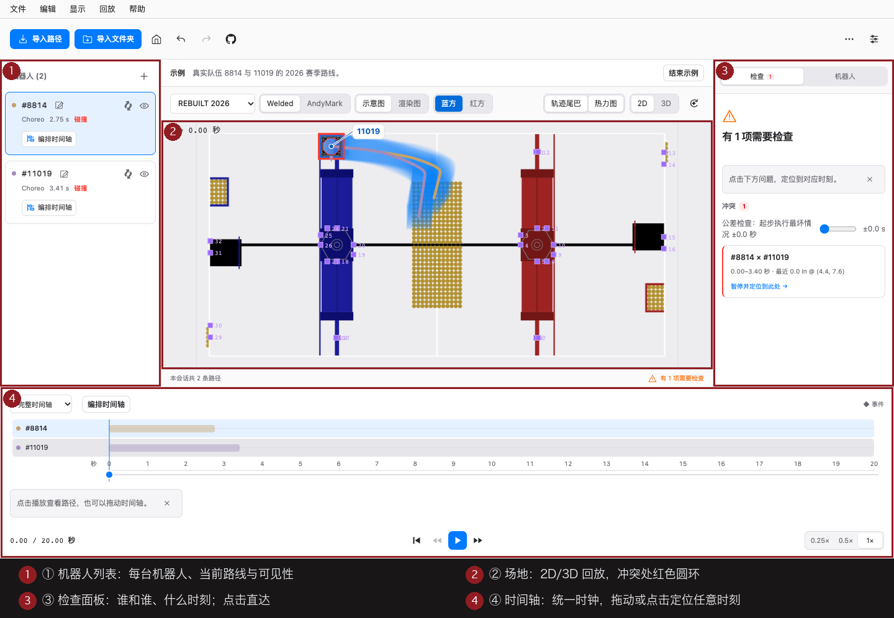
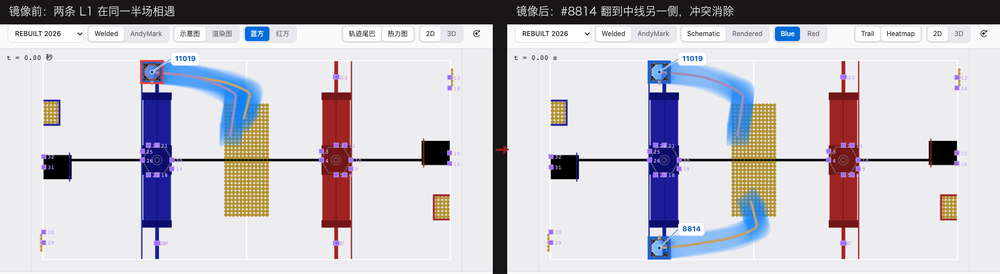

# PathBlender 使用指南（策略组版）

**比赛前，把联盟各队的自动路线放到同一块场地上，同时回放，提前发现机器人之间的碰撞风险。**

给联盟策略组的赛前协调工具。**所有文件都在你的设备上解析，不会上传到任何地方。** PathBlender 是查看器：它负责把问题显示出来；修改发生在路径所属的工具里。适合策略组与编程组；应用内也带一份「快速指南」（帮助菜单 → 快速指南，或欢迎页入口），离线可读。

## 无需文件，试做一次检查

从欢迎页选择 **试做第一次路径检查**，打开练习场上的 A、B、C 三条自制教学路线。
这些是教学数据，不是真实队伍的自动程序，也不代表官方场地几何。

1. 点击 **播放路线**，观察三台机器人按同一时钟运动。
2. 点击 **查看冲突**，播放头跳到 A 与 B 的重叠时刻；场地和检查面板显示实际计算结果。
3. 点击 **让 B 晚两秒出发**，会话的时间安排改变，检查随之重新计算，原始路径采样不变。
4. 点击 **回放调整后的方案**。在未做其他修改的练习中，三台机器人都可见，检查未发现碰撞或越界。这只描述教学数据的结果，不保证真实机器人运行结果。

可以收起引导自由探索、重新开始练习，或结束练习回到欢迎页。
撤销、重做及会话保存／打开使用原有机制（保存需要桌面版）。原有的「体验示例」仍打开路线库示例。

如果有帮助，可以[在 GitHub 上点 Star 支持 PathBlender](https://github.com/LYT259/pathblender)。
遇到问题请[提交 issue](https://github.com/LYT259/pathblender/issues)，无需公开自己的路径文件。

## 第一次完成联盟路径检查

按下面七步走一遍，就能从零完成一次联盟路径检查。手头没有文件？每一步都可以先用欢迎页的**体验示例**练一遍。

### 1. 准备各队文件

| 队用的工具 | 文件 | 怎么做 |
|---|---|---|
| Choreo | `.traj` | 在 Choreo 里导出轨迹 |
| PathPlanner | `.path` + `.auto` | 从项目目录拿文件；**`.auto` 引用到的每个 `.path` 必须同批导入** |
| PathPlanner（加分项） | `settings.json` | 一起导入，所有机器人获得该项目的真实保险杠尺寸 |
| 103 Collaborative fork | `.ghostauto` | 从 fork 导出 ghost——自带机器人尺寸与队名 |

**应该看到什么**：每个队至少一份路径文件；`.auto` 连同它引用的 `.path` 放在同一个文件夹里等会儿一起选。
**没出现预期结果怎么办**：只拿到 `.path` 也能导入——轨迹会按通用机器人参数本地重算并标注「时间为估算值」（见 FAQ）。

### 2. 导入各队路线

欢迎页点**导入路径文件**，多选、混格式一次进；或点**导入文件夹**整包吃进一个队的 deploy 目录（无关文件自动跳过，所有路线进路线库）。

**应该看到什么**：左侧机器人列表出现每个队的机器人（带队号），场地出现在中间，时间轴出现在底部。坏文件会单独报错说明原因，不影响其他文件。

### 3. 检查基础设置

导入后先核对四件事，别在错误的基础上分析：

- **赛季与场地**：顶部选择框应是本赛季（内置 2022–2026）；
- **机器人保险杠尺寸**：点机器人，右侧「详情」页签里核对；`.ghostauto` 与带 `settings.json` 的导入自带真实尺寸，其余按赛季规则尺寸默认；
- **红/蓝联盟**：顶部红蓝切换，切到这些机器人比赛中真正起步的那一侧；
- **时间来源**：`.traj` / `.ghostauto` 的时间来自导出采样；`.path`（无 settings.json）为本地估算——临界结论记得当参考。

### 4. 同时回放

按**播放**。所有机器人在同一个统一时钟上跑（t=0 为自动阶段开始）：暂停、拖动时间轴到任意时刻、0.25×–1× 变速、逐 0.5 秒步进。

**应该看到什么**：多台机器人同时在场地上移动，时间轴上每台机器人一条各自的条带（显示各自真实的起止）。

### 5. 定位检查结果

碰撞风险同时出现在三处：场地上的**红色圆环**、时间轴上的**红色区段**、右侧检查面板的条目——**谁和谁、什么时刻、在哪里**。

**点哪里**：点检查面板里任意一条，时钟直达那个瞬间；机器人驶出边界的时刻会单独标为越界。
**应该看到什么**：时钟跳到冲突时刻，两台机器人在场地红色圆环处贴上/重叠。

### 6. 比较方案

发现冲突后，先在 PathBlender 里对比备选，再决定让谁改：

- **换路线**：机器人列表里每台机器人旁的选择器实时切换它路线库里的另一条路线（撤销即可切回）；
- **调起步时间**：点机器人的**编排**（或按 E），调整它的起步时刻，回放立即按新方案走；
- **空间变换**：见下面「联盟切换与左右镜像」——两者作用范围不同，别混用。

这里的每次调整都只是分析视图：**导入的原始文件不会被改写**。

### 7. 回源修改、再查、保存

确定「谁改什么」后：由路径所属的队在 Choreo / PathPlanner 里改，重新导出，把新文件拖进打开的会话——会话原地更新，再查一遍，重复到时间轴干净为止。最后把结果交给联盟群（桌面版）：保存 `.pb` 会话、导出 GIF 回放、或打包方案包。

## 认识工作区

① 机器人列表（每台机器人、当前路线与可见性）· ② 场地（2D/3D 回放，冲突红环）· ③ 检查面板（谁/何时/哪里，点击直达）· ④ 时间轴（统一时钟，拖动定位）。

## 联盟切换与左右镜像

两个不同的空间变换，看起来相似、作用对象不同：

| | 会话红/蓝联盟切换 | 队伍左右镜像 |
|---|---|---|
| **入口** | 顶部工具栏红蓝切换（查看菜单同款） | 机器人列表行内「左右镜像」按钮（或选中后按 M、编辑菜单） |
| **作用于** | **整套会话**：全部机器人一起变换到所选半场 | **单台机器人**：该机器人及其路线库沿场地中线左右翻转 |
| **什么时候用** | 从机器人真正起步的那半场看同一套融合 | 某队导出的是另一侧联盟坐标的路线 |

内置示例里试一下最直观（帮助菜单 → 入门引导，五步清单会带你走一遍）：示例中镜像 8814 后，它与 11019 的冲突当场消失，再点一次镜像即恢复原状——镜像只是把这台机器人的分析视图翻到中线另一侧。

三点共同边界，演示给新队员时值得先说清：

- 两者都是**派生视图**：原始文件不被改动，碰撞判定用的就是你看到的坐标；
- 两者都**不是时间倒放**：回放仍在统一时钟上向前进行，这是空间翻转；
- 改的是分析中的视图，**不等于已经修改了实车自动程序**——实车要改，仍回源工具。

## 路线库

**导入文件夹**可整包吃进一个队伍的 deploy 目录：无关文件自动跳过，所有路线进入路线库。每台机器人旁的选择器实时切换当前自动（撤销即可切回）——这是对比「他们的 A 方案 vs B 方案」与其余联盟路径的最快方式。

## 3D 视图与场地

- 头部的 **2D / 3D** 切换对每个内置赛季都出现——**FRC 2022–2026** 全部带官方 3D 模型（焊接场/AndyMark 场结构有差异时都提供；2025 两种都有）。自定义导入的场地仅 2D。
- 3D 视图支持自由环绕、一键 **Fit** 适配内容、默认机位按钮回位。
- 2D 视图每个赛季提供**示意图**与**渲染图**两种底图，叠加官方 AprilTag 布局。
- 赛季：内置 2022–2026。其它赛季或练习场地走自定义场地图片导入（标定 + AprilTag 布局 JSON）。

## 其它常用

- **会话文件与导出**（桌面版）：保存/打开 `.pb` 会话（更名前的 `.ghpb.json` 旧会话仍可打开），把准确的场地交给下一场策略会；导出当前 2D 视图的 GIF 回放，或把路径、会话与回放打包成方案包发联盟群。桌面版一切功能都在 PathBlender 菜单里；
- **键盘快捷键**：任意位置按 `?`（帮助菜单 → 键盘快捷键）；
- **外观与语言**：偏好设置里深色/浅色/跟随系统（桌面 ⌘,）；界面支持 43 种语言——English (United States)、English (United Kingdom)、简体中文、繁體中文（香港）、繁體中文（澳門）、繁體中文（台灣）、Français、Español、Deutsch、Italiano、Português (Brasil)、Nederlands、Polski、Čeština、Türkçe、Ελληνικά、עברית、العربية、हिन्दी、日本語、한국어 等，完整清单见语言菜单（每行右侧带 简/繁/EN/あ/한 等短文字标识，不用旗帜）；未手动选择时跟随系统语言；
- **更新**（桌面版）：菜单 **PathBlender → 检查更新…**；偏好设置 → 更新 可切换 stable / beta 通道。Linux 上应用内更新走 AppImage；DEB/RPM 安装的用户下载新包覆盖安装即可更新。

## 网页版与桌面版

| | 网页版 | 桌面版（macOS / Windows / Linux） |
|---|---|---|
| 导入 / 回放 / 碰撞检查 | ✓ | ✓ |
| 保存与打开会话文件 | 仅打开 | ✓ |
| GIF 回放 / 方案包导出 | — | ✓ |
| 文件夹导入 / 路线库 | ✓ | ✓ |
| 应用内更新 | — | ✓ |

## FAQ

**问：导入 `.path` 提示「按默认机器人配置生成——时间为估算值」？**
`.path` 只存路径点；未导入该项目的 `settings.json` 时，轨迹按通用机器人参数本地重算，时间轴与实车可能相差几百毫秒——临界碰撞结论请当作参考，关键时间点找两队当面核对。

**问：导入 `.auto` 提示「例程引用了路径……请一并导入对应 .path」？**
`.auto` 是例程（路径引用 + 等待/命令）。把对应的 `.path` 和 `.auto` **同批**导入即可。

**问：自动阶段 15 秒，时间轴却更长/更短？**
2026 赛季自动阶段为 20 秒；更早赛季 15 秒。时间轴长度 = 含导入起步延迟的最长轨迹；每台机器人的条带显示各自真实的起止。

**问：我的数据安全吗？**
安全：无后端、无账号、无遥测。网页构建不发出任何网络请求；桌面版只有你主动「检查更新」时才访问 GitHub Releases。解析全程在本机内存；会话数据只有你自己保存或导出时才离开应用。

**问：文件导入失败？**
按[反馈模板](community/feedback-template.md)到
[GitHub Issues](https://github.com/LYT259/pathblender/issues) 提交——格式漂移报告（工具 + 版本 + 报错文字）正是我们需要的。绝不会要求你公开路径文件。
